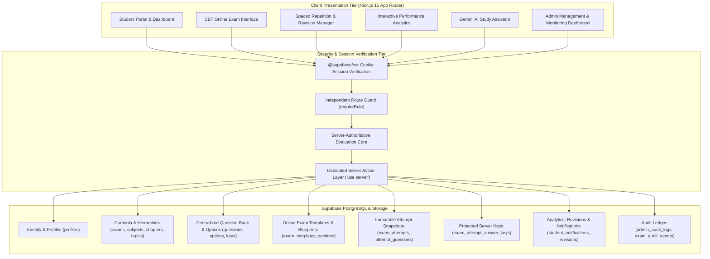

# PrepTrack — Comprehensive System Architecture & Technical Documentation

PrepTrack is an enterprise-grade competitive examination preparation and management platform tailored for aspirants targeting GATE, UPSC, KAS, Railway (RRB NTPC/JE), KEA (Land Surveyor, VAO, SDA, FDA), and AE Civil Engineering.

---

## 1. High-Level System Architecture



---

## 2. Directory Structure

```
PrepTrack/
├── src/
│   ├── app/
│   │   ├── actions/               # Next.js Server Actions ('use server')
│   │   │   ├── analytics.ts       # Phase 5: Revisions, notifications, Gemini AI assistant, audit logs
│   │   │   ├── events.ts          # Phase 2: Official examination schedule events
│   │   │   ├── exams-online.ts    # Phase 4: Mock test lifecycle, autosave, server evaluation
│   │   │   ├── exams.ts           # Phase 2: Exam portfolio management
│   │   │   ├── planner.ts         # Phase 2: Automated study schedule planner
│   │   │   ├── questions.ts       # Phase 3: MCQ question bank authoring, import & AI generation
│   │   │   ├── syllabus.ts        # Phase 2: Subject, chapter, topic CRUD & tracking
│   │   │   └── tasks.ts           # Phase 2: Study task routine execution
│   │   ├── admin/                 # Administrator Portal
│   │   │   ├── analytics/         # Phase 5: Institutional growth & platform metrics
│   │   │   ├── audit-logs/        # Phase 5: Immutable administrative audit trail
│   │   │   ├── dashboard/         # Platform high-level overview
│   │   │   ├── events/            # Examination event notices
│   │   │   ├── exams/             # Exam creation, blueprint configuration, monitoring
│   │   │   │   ├── create/        # Form builder for new tests
│   │   │   │   ├── manage/        # Published test catalog & status toggle
│   │   │   │   └── monitor/       # Live attempt supervisor & 1-click result release
│   │   │   ├── questions/         # Central question bank management
│   │   │   │   ├── ai/            # Gemini-powered question batch creator
│   │   │   │   ├── create/        # Manual question authoring
│   │   │   │   ├── import/        # Bulk CSV / Excel parser
│   │   │   │   ├── quality/       # Phase 5: Content quality & coverage gap monitor
│   │   │   │   └── review/        # Pedagogical review queue
│   │   │   ├── subjects/          # Subject directory
│   │   │   └── syllabus/          # Hierarchical syllabus tree editor
│   │   ├── api/                   # API Route Handlers
│   │   │   └── cron/reminders/    # Phase 5: Idempotent batch reminder processor
│   │   ├── auth/                  # Authentication callbacks & signout
│   │   ├── login/ & register/     # Student & Admin registration/authentication
│   │   ├── profile/               # User account profile
│   │   └── student/               # Student Aspirant Portal
│   │       ├── analytics/         # Phase 5: Real-time subject & topic performance drilldown
│   │       ├── assistant/         # Phase 5: Gemini AI contextual study advisor
│   │       ├── calendar/          # Full calendar of daily targets and exams
│   │       ├── dashboard/         # Student home with KPIs & study recommendations
│   │       ├── exams/             # Exam portfolio & Online Mock Tests
│   │       │   └── online/        # Catalog, pre-exam instructions, CBT live test, results
│   │       ├── export/            # Phase 5: Full CSV & JSON student data portability
│   │       ├── notifications/     # Phase 5: Notification center & category settings
│   │       ├── planner/           # Intelligent weekly study plan generator
│   │       ├── practice/          # Phase 3: MCQ practice modes (Topic, Subject, Exam, PYQ, Bookmarks, Mistake Notebook)
│   │       ├── reports/           # Phase 5: Daily, weekly, monthly printable audit reports
│   │       ├── revisions/         # Phase 5: Spaced repetition (1d, 3d, 7d, 14d, 30d) review manager
│   │       ├── routine/           # Daily routine time allocations
│   │       ├── syllabus/          # Student syllabus tracker & completion toggles
│   │       └── tasks/             # Daily study task board
│   ├── components/                # Modular UI Components (Navbar, Sidebar, etc.)
│   └── lib/                       # Core Utilities
│       ├── auth.ts                # Session verification & role guard utilities
│       ├── types.ts               # Complete TypeScript domain contracts (Phases 1–5)
│       ├── data/                  # Server-side data fetching layer
│       │   ├── analytics.ts       # Phase 5 analytics, weak areas, notifications, reports
│       │   ├── exams-online.ts    # Phase 4 exam templates, results, monitoring
│       │   ├── questions.ts       # Phase 3 question bank queries
│       │   └── syllabus.ts        # Phase 2 syllabus & routine data
│       └── supabase/              # Browser, server, and service-role Supabase clients
├── supabase/migrations/           # Deterministic PostgreSQL Migrations
└── docs/                          # Runbooks & Architecture Specifications
```

---

## 3. Database Schema Overview Across All Phases

### Phase 1: Identity & Profiles
- `profiles`: Extends Supabase `auth.users` with `full_name`, `role` (`student` or `admin`), `avatar_url`.

### Phase 2: Syllabus & Study Management
- `exams`: Official examination catalog (GATE, UPSC, KAS, Railway, KEA, AE Civil).
- `student_exams`: Multi-exam enrollment with target dates and priorities.
- `subjects`, `chapters`, `topics`: Reusable 3-tier syllabus tree.
- `exam_subject_mappings`, `exam_topic_mappings`: M-to-N examination curriculum mapping.
- `topic_progress`: Student progress tracking with confidence ratings and timestamps.
- `study_preferences`, `routine_templates`, `study_tasks`: Daily routine time allocation.
- `revision_schedules`: Spaced repetition schedule.
- `exam_schedule_events`: Official notification calendar.

### Phase 3: Centralized MCQ Question Bank
- `question_banks`: Container sets for subject and exam questions.
- `questions`: Multi-attribute questions (difficulty, source, PYQ year, publication status).
- `question_options`: Four answer options (A, B, C, D) per question.
- `question_answer_keys`: Protected answer keys and detailed explanations.
- `practice_sessions` & `question_attempts`: Student practice answers, timer, and correctness.
- `question_bookmarks`: Bookmarked questions for review.
- `question_import_batches` & `ai_question_generation_jobs`: Bulk and AI audit trails.

### Phase 4: Online Examination & CBT System
- `exam_templates`: Online mock exam definitions (duration, marks, negative marking, randomization).
- `exam_sections`: Configurable multi-section structures with section time limits.
- `exam_question_mappings` & `exam_question_blueprints`: Fixed and dynamic blueprint question assembly.
- `exam_attempts`: Candidate attempts with server-authoritative `started_at` and `expires_at`.
- `exam_attempt_questions`: Immutable snapshot created at attempt initialization.
- `exam_attempt_answers`: Autosaved student selections and review marks.
- `exam_attempt_answer_keys`: Server-only answer key store.
- `exam_results`: Evaluated scorecards with positive/negative marks and sectional breakdowns.
- `exam_audit_events`: Security event log.

### Phase 5: Analytics, Revisions, Notifications & Audit
- `student_study_recommendations`: Rule-based study advice with actionable links.
- `student_notifications`: In-app notification center alerts.
- `student_notification_preferences`: Category toggles, quiet hours, and timezone settings.
- `reminder_job_runs`: Batch automation execution status log.
- `admin_audit_logs`: Administrative operation audit trail.
- `student_ai_interactions`: History of Gemini AI study advisory chats.
- `student_weak_area_dismissals`: Dismissed weak area tracking.

---

## 4. Key Security & Integrity Guarantees

1. **Answer-Key Confidentiality:** Neither practice nor mock exam answer keys are ever delivered to the browser before evaluation or release.
2. **Server-Authoritative Timing:** Timers are derived on the server (`expires_at = started_at + duration`). Post-expiry autosaves and submissions are strictly rejected and auto-submitted.
3. **Data Isolation:** Row Level Security (RLS) ensures students cannot query or modify another student's practice attempts, revisions, tasks, or exam scorecards.
4. **Role Integrity:** Students cannot elevate their own role in `profiles`; server actions and page handlers independently re-verify roles via `requireRole()`.
5. **Secret Protection:** Secrets (`SUPABASE_SERVICE_ROLE_KEY`, `GEMINI_API_KEY`, `CRON_SECRET`) are restricted to server-side executions and never bundled in client code.
